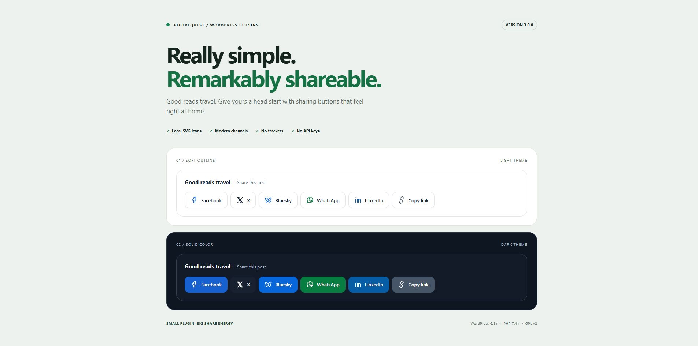

# Really Simple Social Sharing Buttons

### Good reads travel. Give yours a head start.

A small WordPress plugin for sharing worth clicking. Crisp buttons, modern channels, and a setup screen you can finish before your coffee gets cold.

**Version 3.0.0 · WordPress 6.3+ · PHP 7.4+ · GPL v2**



## Small footprint. Full personality.

- **Three looks:** soft outline, solid brand colors, or minimal. Choose light, dark, or follow the reader’s device.
- **Built for thumbs:** wrapping layouts, 44px minimum targets, and optional icon-only buttons on small screens.
- **Share your way:** Facebook, X, Bluesky, WhatsApp, LinkedIn, Reddit, Pinterest, Telegram, email, copy link, and the device’s native share sheet. Gab, Gettr, and Truth Social remain available.
- **Your placement:** above posts, below posts, both, or exactly where you put the shortcode.
- **Local SVG icons:** no Font Awesome download, third-party fonts, or social SDKs.
- **Accessible by design:** keyboard focus, descriptive button names, announced copy feedback, reduced-motion support, and high-contrast mode styles.
- **No account or API keys:** configure your channels and get on with publishing.

Normal sharing links work without JavaScript. A small dependency-free script adds copy-link feedback and native sharing where supported.

## Up and running

1. Download the repository using **Code → Download ZIP**, then extract it.
2. Rename the extracted folder to `really-simple-social-sharing-buttons` and put it in `wp-content/plugins/`. You can also ZIP that renamed folder and upload it through **Plugins → Add New Plugin → Upload Plugin**.
3. Activate **Really Simple Social Sharing Buttons**.
4. Open **Social Sharing** in your WordPress dashboard. Choose your channels, placement, button style, theme, and labels, then select **Save your setup**.

Fresh installs start with Facebook, X, Bluesky, WhatsApp, LinkedIn, email, and copy link, above and below single blog posts. Uncheck every channel to turn the buttons off.

## Put sharing where it belongs

Automatic placement applies to the main content of single blog posts. It skips archives, feeds, secondary loops, and password-protected content.

For manual placement, add a **Shortcode** block to a public post or page:

```text
[rssb_share]
```

A post containing this shortcode skips automatic placement, so it gets only the sharing groups you explicitly added. Choose **Manual / shortcode only** to disable automatic placement everywhere.

Theme authors can render the current public post with:

```php
<?php
if (function_exists('rssb_render_buttons')) {
    echo rssb_render_buttons(); // The plugin escapes the generated markup.
}
?>
```

Styles and the script load on singular views and the plugin’s settings screen. If you deliberately render the helper on an archive or another custom view, enqueue `rssb_enqueue_assets()` from your theme’s `wp_enqueue_scripts` callback on that view.

## A few things to know

| Feature | Behavior |
| --- | --- |
| **X** | The old `Twitter` setting is preserved; the button now displays X. |
| **Pinterest** | Appears only when the post has a featured image to share. |
| **Copy link** | Uses the browser clipboard. If access is unavailable or denied, reveals a selected link for manual copying. Requires JavaScript. |
| **More options** | Opens the native share sheet only on supported browsers in a secure context, typically HTTPS. Hidden when unavailable; requires JavaScript. |
| **Email** | Opens the reader’s mail application with the post title and URL. |
| **Follow device** | Uses the reader’s light/dark preference. Select a fixed theme to match a site that doesn’t follow that preference. |

Sharing opens a provider’s compose page; the reader still chooses whether to publish. Individual services control their own sign-in and sharing availability.

## Upgrading from 2.1

Replace the existing plugin files in the **same plugin directory**, then clear any page or asset cache. Your saved network selections, including an intentionally empty selection, stay intact. New channels are available in the dashboard but aren’t silently enabled on existing installs.

Version 3 changes the button markup and visual design. The `social-share-buttons`, `social-share-button`, `social-share-text`, and network classes such as `share-twitter` remain for custom CSS. Check existing overrides after upgrading. The old generic PHP functions were internal helpers; custom theme integrations should use `rssb_render_buttons()`.

WordPress 6.3 and PHP 7.4 are the minimum supported versions. Use a currently maintained WordPress/PHP release on a live site.

## Privacy, permissions, and credentials

The plugin stores selected network names and display preferences in two WordPress options: `social_sharing_networks` and `social_sharing_settings`.

- It doesn’t collect passwords, store social access tokens, create visitor cookies, count clicks, or send analytics.
- It makes no server-side social API requests and loads no third-party scripts, fonts, or styles. Icons and assets are served by your site.
- Sharing links contain the public post URL, plus its title and featured image URL where needed. Clicking a link takes the reader to that service, whose privacy policy and session cookies then apply.
- WordPress handles administrator login and sessions. Viewing or saving plugin settings requires the `manage_options` capability. Saves also verify a WordPress nonce to protect against cross-site request forgery, allowlist input, and escape output.
- Private, draft, and currently password-protected posts don’t render sharing buttons. A WordPress nonce is a form-protection token, not a social credential or a substitute for permission checks.

## Make it fit your theme

All new styles use the `.rssb` prefix. Override the toolbar’s CSS variables in your theme or Additional CSS:

```css
.rssb {
    --rssb-bg: #fafaf7;
    --rssb-ink: #17251e;
    --rssb-muted: #536359;
    --rssb-line: #dce5df;
    border-radius: 16px;
}
```

The plugin uses system fonts and inherits page direction. The toolbar is hidden when printing.

## Development

No package install or build step. The runtime is one PHP file, one stylesheet, and one JavaScript file.

```sh
php -l really-simple-social-sharing-buttons.php
node --check social-sharing.js
node tests/browser.js
php tests/smoke.php /path/to/disposable-wordpress/wp-load.php
```

The JavaScript checks exercise clipboard success/fallback and native-share availability, cancellation, and errors using Node's built-in tools. The smoke check runs against real WordPress, temporarily creates test content, checks legacy settings, validates URL escaping, exercises placement and protected content, and restores the test options. Use a disposable test site, never production.

Version 3 was checked on WordPress 6.3 and 7.1.3 with PHP 8.2, plus desktop and mobile-width Chrome. Native share behavior was checked with a simulated browser API; availability on a physical device depends on its browser and operating system.

Found a bug? [Open an issue](https://github.com/riotrequest/really-simple-social-sharing-buttons/issues) with the WordPress/PHP versions, theme, browser, and steps to reproduce it.

## Changelog

### 3.0.0

- Rebuilt the toolbar and dashboard with three button styles, light/dark themes, responsive labels, and self-contained SVGs.
- Added Bluesky, WhatsApp, copy link, native sharing, and the `[rssb_share]` shortcode; refreshed X and LinkedIn sharing URLs.
- Added placement controls, empty-selection handling, and upgrade-safe network settings.
- Hardened settings input and generated links; prevented automatic sharing groups in feeds, secondary loops, and protected content.
- Removed the external Font Awesome dependency; added keyboard, motion, and screen-reader improvements.
- Rewrote the documentation and added a runnable WordPress smoke check.

### 2.1

Added dashboard network selection and responsive icon-only buttons.

### 2.0

Initial sharing buttons release.

---

Made by [RiotRequest](https://github.com/riotrequest). Licensed under [GPL v2](https://www.gnu.org/licenses/gpl-2.0.html).
